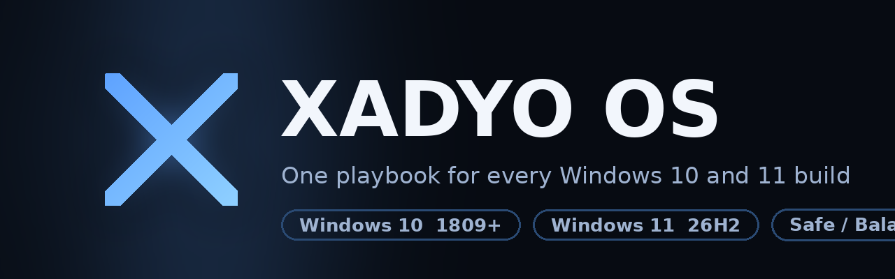

# XADYO OS

**One playbook for every Windows 10 and 11 build.** Debloat, privacy and performance
in one build-aware AME Wizard pass — backed up, logged, reversible.

  
  

| | |
| :-- | :-- |
| 🌐 **Website** | [https://xadyoos.vercel.app](https://xadyoos.vercel.app) |
| 🧩 **XADYO OS playbook** | [adityagg13/X-ADYO-OS](https://github.com/adityagg13/X-ADYO-OS) |
| 📥 **Download** | [latest .apbx package](https://github.com/adityagg13/X-ADYO-OS/releases/latest) |
| 📜 **License** | GPL-3.0 — free forever |

`Windows 10 (1809+)` · `Windows 11 (21H2–26H2)` · `Safe / Balanced / Extreme` · `Restore point + backups + partial undo`

