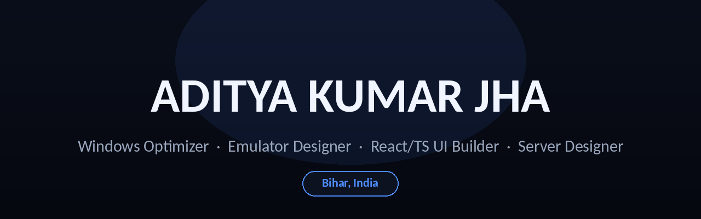

## Hi, I'm Aditya 👋

- **Windows optimizer** — debloating, tweaking and making machines feel new
- **Emulator designer** — building clean emulation setups
- **React / TypeScript UI builder** — clean, modern interfaces
- **Server designer** — setup, tuning and management

📍 Bihar, India

---

### ⚡ Tech stack

  
  
  
  
  
  
  
  

### 📊 GitHub stats

<table>
  <tr>
    <td></td>
    <td></td>
  </tr>
</table>

### 🌐 Connect with me

  
  

<picture>
  <source media="(prefers-color-scheme: dark)" srcset="https://raw.githubusercontent.com/adityagg13/adityagg13/output/snake-dark.svg" />
  
</picture>
