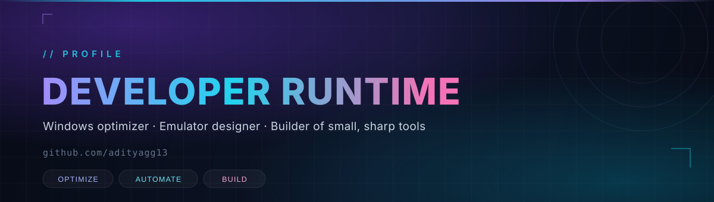

<div align="center">
  
</div>

<div align="center">
  <a href="mailto:adityakumarjha5052@gmail.com"></a>
  <a href="https://github.com/adityagg13"></a>
  
</div>

<br/>

## `$ whoami`

```yaml
name:      Developer Runtime
handle:    adityagg13
role:      Windows optimizer · Emulator designer · Web & UI builder
stack:     PowerShell · Windows internals · React · TypeScript · UI design
focus:     making slow machines feel new again — and clean interfaces people love
status:    building LITEXOS
```

I like the part of computing most people skip: the layer underneath. Services that should not be running, packages nobody asked for, emulators that stutter for no reason. I take those apart and put back only what earns its place. And on the surface — I design and build the interfaces too: dark, fast, minimal web pages that load like they mean it.

<br/>

## Selected work

<table>
  <tr>
    <td width="50%" valign="top">
      <h3>LITEXOS Playbook</h3>
      <p>A single-pass Windows playbook for AME Wizard. Debloat, privacy, performance and a full toolkit — then automatic LZX compression at the end.</p>
      <p><code>PowerShell</code> <code>YAML</code> <code>AME</code></p>
      <sub>Private build · v1.0</sub>
    </td>
    <td width="50%" valign="top">
      <h3>Developer Runtime Customizer</h3>
      <p>My own customization suite for turning a fresh install into a machine that boots quiet and idles low.</p>
      <p><code>PowerShell</code> <code>Windows APIs</code></p>
      <sub>Private project</sub>
    </td>
  </tr>
  <tr>
    <td width="50%" valign="top">
      <h3><a href="https://github.com/adityagg13/saas-landing">SaaS Landing</a></h3>
      <p>Dark, animated marketing page with a lean build and an edge worker in front of it.</p>
      <p><code>Vite</code> <code>React 19</code> <code>Cloudflare</code></p>
      <sub>Public repo · live demo link coming</sub>
    </td>
    <td width="50%" valign="top">
      <h3>Emulator Toolkit</h3>
      <p>Ad and bloat removal, leftover cleanup, virtualization checks, GPU preference and CPU priority tuning for Android emulators.</p>
      <p><code>PowerShell</code> <code>ADB</code> <code>Windows</code></p>
      <sub>Part of LITEXOS TOOL</sub>
    </td>
  </tr>
</table>

<br/>

## Toolbox

<div align="center">
  
  
  
  
  
  
  
  
</div>
<div align="center">
  
  
  
  
  
  
</div>

<br/>

## `$ git stat`

> Recruiters skim — so the numbers carry my color palette too.
> (Fresh account, bare numbers for now — they fill themselves as I ship.)

<div align="center">
  
  
</div>

<div align="center">
  
</div>

<div align="center">
  <picture>
    <source media="(prefers-color-scheme: dark)" srcset="https://raw.githubusercontent.com/adityagg13/adityagg13/output/snake-dark.svg" />
    <source media="(prefers-color-scheme: light)" srcset="https://raw.githubusercontent.com/adityagg13/adityagg13/output/snake.svg" />
    
  </picture>
</div>

<br/>

## Currently

| | |
| :-- | :-- |
| **Building** | LITEXOS Playbook — a whole Windows setup pass in one click |
| **Sharpening** | The emulator toolkit: detection, ad cleanup, virtualization, GPU and CPU tuning |
| **Designing** | Dark, minimal web UIs and landing pages that load in a blink |
| **Learning** | Storage internals, signed drivers and clean installer design |
| **Open to** | Windows tooling, emulator performance, web/UI work and small automation |

<br/>

## How I work

- **Measure first.** If it does not show up in Task Manager, LatencyMon or a stopwatch, it is decoration.
- **Reversible by default.** Every change should have a way back.
- **Fewer prompts.** Good tooling decides once and then stays out of the way.
- **Ship the small thing.** A script that works today beats an architecture that ships next quarter.

<br/>

<div align="center">
  <sub>Fast is a feature. Quiet is a feature. Clean is a feature.</sub>
</div>
